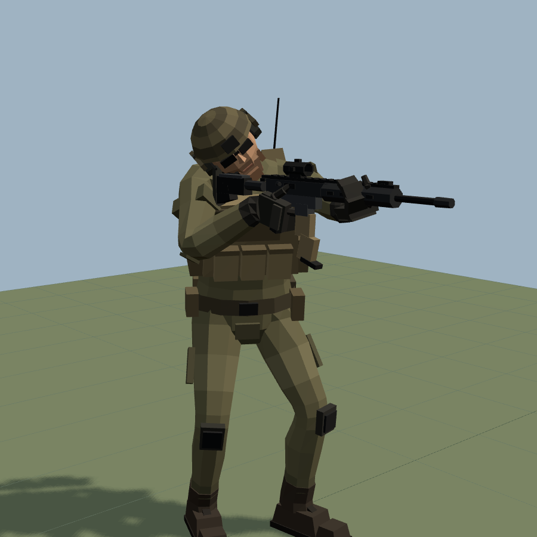
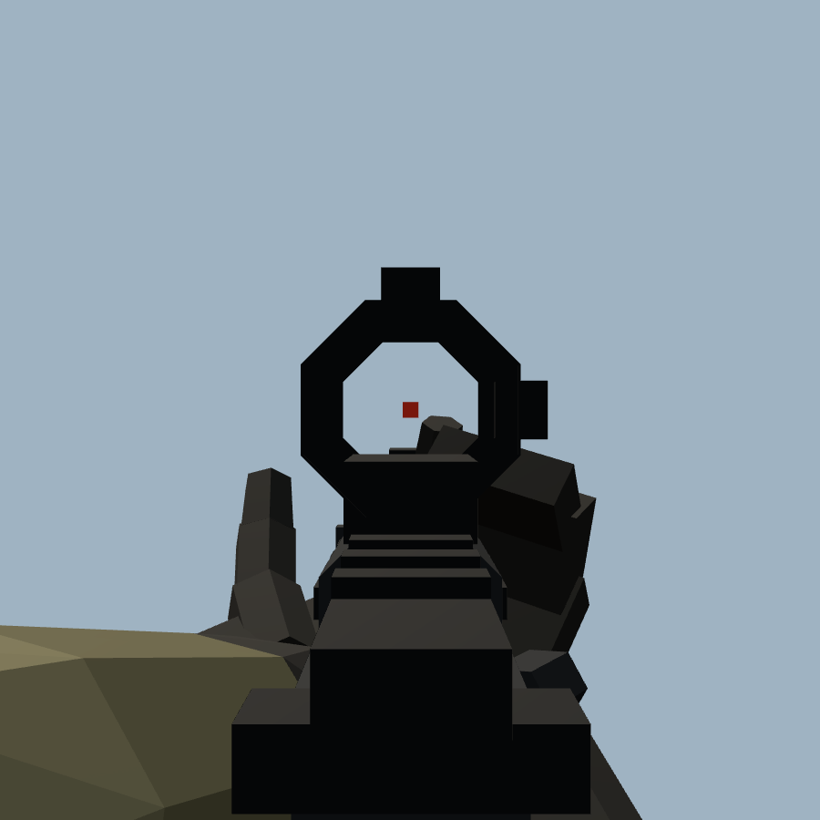
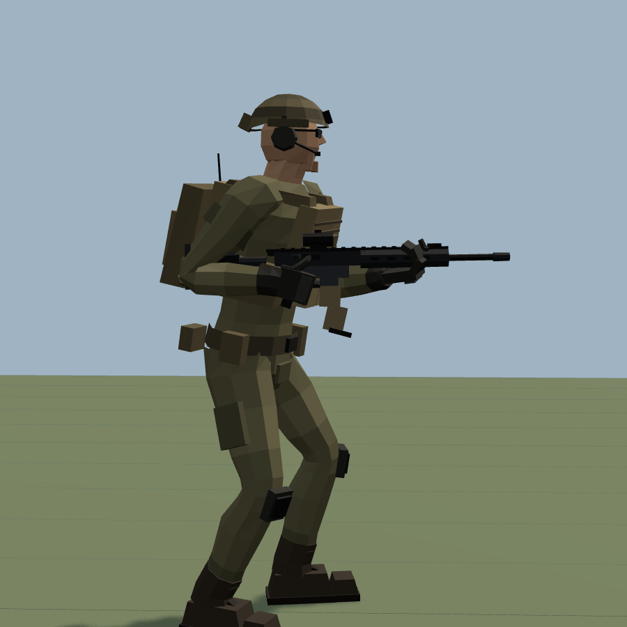
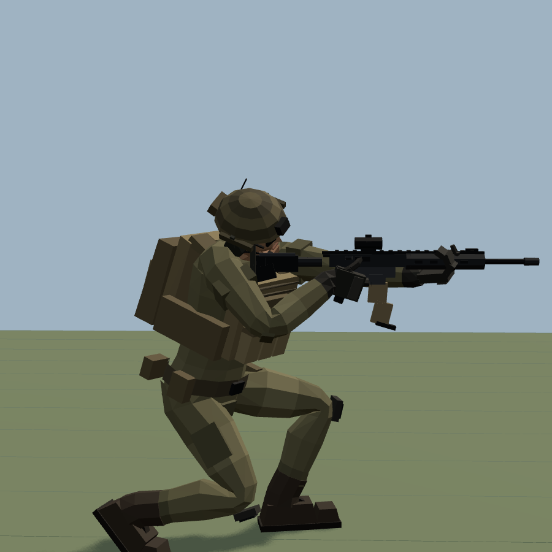
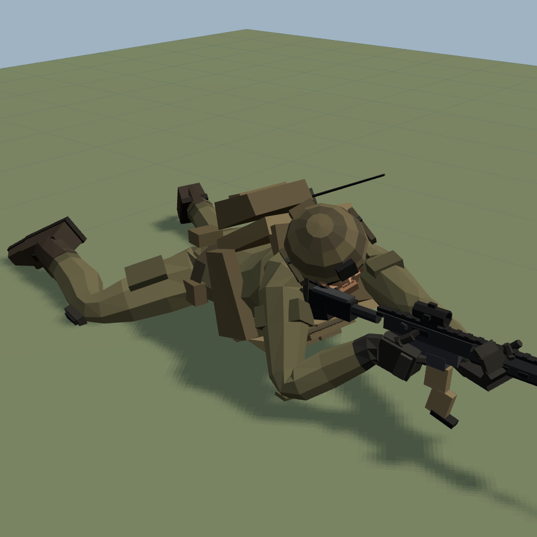

# Soldier Simulator

A flat-shaded, low-poly, fully rigged infantry soldier with rifle animations, plus a browser simulator to preview and play them.
Everything exports to a single **`exports/soldier.glb`** (mesh + skeleton + rifle + 43 animation clips) that you can import into Unity, Unreal, Godot or Blender.



| Aim down sights: right-eye view through the optic | Hip fire with the stock tucked under the right arm |
|---|---|
|  |  |
| **Crouched, aiming** | **Prone firing position** |
|  |  |

## What's in the box

* **Soldier model.** A stocky, armoured build with a short, thick neck. One skinned mesh, one material and about 3.2k triangles. It is flat shaded from true face normals, so it stays faceted in any engine, and coloured through a small palette texture. The kit is a high-cut helmet with headset and NVG mount, ballistic glasses, combat shirt, plate carrier with mag/admin pouches, radio, assault pack, battle belt, knee pads, gloves and boots.
* **Rifle.** A generic carbine of original design with a red-dot optic (the reticle is modelled). It is attached to a `Weapon_R` socket bone on the right hand and carries named attach points: `Muzzle`, `Ejection`, `SightLine` and `LeftHand_IK`.
* **Skeleton.** 44 bones with Mixamo-style names (`Hips`, `Spine`…`Spine2`, `Neck`, `Head`, `LeftArm`, `LeftForeArm`, `LeftHand`, finger chains, `LeftUpLeg`, `LeftLeg`, `LeftFoot`, `LeftToeBase`…). It is bound in a T-pose. Units are metres, +Y is up and the character faces +Z.
* **Animations.** 43 clips baked at 60 fps:

| Group | Clips |
|---|---|
| Locomotion (in place) | `Idle` (low ready, breathing, weight shift, scan), `Walk` 1.25 m/s, `Run` 4.3 m/s, `ADS_Walk` 0.9 m/s, `HipFire_Walk` 0.9 m/s |
| Weapon stances | `ADS_Idle`, `HipFire_Idle` |
| Firing | `ADS_Fire`, `ADS_Fire_Auto` (700 RPM loop), `HipFire_Fire`, `HipFire_Fire_Auto` |
| Transitions | `Idle_To_ADS`, `ADS_To_Idle`, `Idle_To_HipFire`, `HipFire_To_Idle`, `HipFire_To_ADS`, `ADS_To_HipFire` |
| Crouch | `Crouch_Idle`, `Crouch_Walk` 0.85 m/s, `Crouch_ADS_Idle`, `Crouch_ADS_Walk`, `Crouch_ADS_Fire`, `Crouch_ADS_Fire_Auto`, `Stand_To_Crouch`, `Crouch_To_Stand`, `Crouch_To_Crouch_ADS`, `Crouch_ADS_To_Crouch` |
| Prone | `Prone_Idle` (aiming), `Prone_Fire`, `Prone_Fire_Auto`, `Prone_Crawl` 0.20 m/s (belly crawl), `Stand_To_Prone`, `Prone_To_Stand` |
| Jump | `Jump` (full), `Jump_Start`, `Jump_Air` (loop), `Jump_Land` |
| Static poses | `Idle_Pose`, `ADS_Pose`, `HipFire_Pose`, `Crouch_Pose`, `Crouch_ADS_Pose`, `Prone_Pose` (aim-offset / additive references) |

Per-clip metadata is in [`exports/animations.json`](exports/animations.json) and in the glTF `extras` of the `Soldier` node: duration, loop flag, in-place speed, shot times and jump take-off/landing times. Details are in [docs/ANIMATIONS.md](docs/ANIMATIONS.md).

## Run the simulator

```bash
npm install
```

```bash
npm run serve
```

Then open <http://localhost:8080/>. No build step is needed; Three.js is vendored in `vendor/`.

* **Viewer** lets you pick any clip, cross-fade between clips, scrub, step frames and change playback speed. You can also show the skeleton or wireframe and switch between camera presets. In-place clips scroll the ground at the clip's speed, so you can check that planted feet stay locked.
* **Play (WASD)** is a third-person sandbox with a firing range:
  * `W A S D`: move. `Shift`: run. `Space`: jump.
  * `C`: crouch / stand. `Z`: go prone / stand up. While prone, `W A S D` crawls.
  * `RMB`: aim down sights. `LMB`: fire. `H`: toggle the hip-fire stance.
  * `V`: look through the soldier's right eye down the optic. `L`: bore-sight laser along the barrel. `Esc`: back to the viewer.

  The upper body turns so the barrel's bore axis passes exactly through the crosshair point (within 0.01°). Every round is cast along the bore and lands where it hits, with a bullet hole and dust. Firing layers additive recoil on top of the locomotion and spawns muzzle flash, tracers and ejected brass. While aiming, the pelvis turns toward the move direction and the chest keeps aiming. Moving backward plays the walk in reverse.
* **⬇ Export GLB** downloads the same file as `exports/soldier.glb`.

## How the animation is made

The clips are not hand-keyed curves. Each frame is a high-level pose (pelvis, chest and head orientation, foot placement, weapon placement) that a full-body solver turns into bone rotations (`src/solver.js`):

1. **Feet.** A gait model (`src/motion.js`) plants each foot and rolls it heel → flat → ball → toe-off, pivoting about the heel and then the ball of the foot. A planted contact point moves backward at exactly the ground speed, so in-place clips have zero foot skate. The swing foot follows a Hermite path that matches velocities at toe-off and heel strike and has a clearance bump. Two-bone leg IK solves the knees. Pelvis height is clamped so the legs never over-extend, then smoothed periodically.
2. **Pelvis and spine.** Pelvic rotation, obliquity, lateral sway and vertical bob are phase-locked to the gait. The spine counter-rotates so the chest, and with it the rifle, stays stable. The spine bones share the pelvis-to-chest rotation between them.
3. **Rifle placement.** The rifle is placed relative to the chest:
   * Low ready / run: the butt sits in the shoulder pocket.
   * Hip fire: the stock is clamped under the right arm.
   * ADS: the butt sits in the shoulder pocket and the barrel points straight ahead.
4. **Hands.** Two-bone arm IK locks the right hand to the pistol grip and the left hand under the handguard. Elbow poles are chosen per stance, and forearm twist is shared between forearm and wrist. The index finger lies straight along the receiver until the soldier fires, then rests on and presses the trigger.
5. **Cheek weld.** For every aiming stance (standing, crouched and prone), an optimiser (Nelder–Mead) solves neck flexion, head tilt and shoulder elevation within comfortable joint ranges, so the right eye sits on the optic's sight line. It lands within about 0.2 mm in the static poses and within 2 mm while walking. The solutions are cached in `src/calib-cache.js`; run `npm run calibrate` after changing a stance or the skeleton.
6. **Secondary motion.** A damped spring driven by the torso's vertical acceleration makes the rifle lag and dip with each footfall and on jump landing. Recoil is a damped-oscillator impulse: the muzzle climbs, the stock drives back into the shoulder, and the chest and shoulder absorb the kick with a slight delay. Automatic fire sums the impulses periodically, so the loop is seamless.
7. **Natural walking.** The upper body isn't a rigid turret:
   * The thorax counter-rotates against the pelvis.
   * The chest leans into each weight transfer and dips on the loading response.
   * The shoulders bounce just after each footfall, and the head nods and settles.
   * The rifle lags vertically and sideways on damped springs.
   * Knees stay soft through stance, and the left and right steps aren't mirror-perfect.
   * Hip sway and tilt are kept small for a squared-off, loaded-soldier gait.
8. **Crawl and prone.** The crawl keeps the belly on the ground. Each forearm plants as a ground contact that moves backward at the crawl speed, and the opposite knee is drawn up sideways along the ground, then straightens as the body slides over it. Chest pitch is solved each frame so the forearms reach the ground, and the rifle stays cradled across both forearms. Getting down to prone and back up is a multi-key motion: crouch → both knees → onto the forearms → legs back → aim. It interpolates smoothly through every key.
9. **Jump.** The jump has an anticipation crouch, an explosive extension with heel rise, and true ballistic flight (g = 9.81 m/s², 0.5 s airtime, about 0.3 m rise). The knees tuck in the air, and the landing is toes first with a deep absorb.

The biomechanics and marksmanship references behind the numbers are listed in [docs/REFERENCES.md](docs/REFERENCES.md).

## Quality checks

```bash
npm run validate
```

This bakes every clip and prints the worst foot-target error, hand-to-weapon error and eye-to-sight-line distance per clip. Current results:
* All feet are within 0.1 mm.
* All hands are within 5 mm.
* In the aim clips the eye stays within 1 mm of the sight line, except while recoil intentionally disturbs it.

```bash
npm run export
```

This re-bakes headlessly, writes `exports/soldier.glb` and `exports/animations.json`, and round-trip loads the GLB. The exported file passes the Khronos glTF validator with 0 errors.

## Importing into an engine

| Engine | Notes |
|---|---|
| **Godot 4** | Drop `soldier.glb` into the project. It imports natively with all clips in an `AnimationPlayer`. |
| **Unreal 5** | Import the GLB (Interchange glTF) as a Skeletal Mesh with animations. Put locomotion in place (or drive root motion from `inPlaceSpeed`). |
| **Unity** | Use glTFast or UnityGLTF, or open the GLB in Blender and export FBX. Set the rig to **Humanoid**: the bone names auto-map and the bind pose is a T-pose. |
| **Blender** | File → Import → glTF 2.0. The clips appear as Actions. |

Tips:
* **In-place clips.** Move your character controller at `inPlaceSpeed` (`Walk` 1.25, `Run` 4.3, `ADS_Walk` 0.9, `Crouch_Walk` 0.85, `Prone_Crawl` 0.20 m/s) so the feet stay locked to the ground.
* **Weapon socket.** The rifle hangs off `Weapon_R`. To swap guns, attach your own weapon to that bone. The grip origin is the weapon origin, +Z is the muzzle and +Y is up.
* **Support hand.** Use the `LeftHand_IK` node with your engine's two-bone IK to keep the left hand on the handguard when blending or layering.
* **Recoil layering.** Use `ADS_Pose` / `HipFire_Pose` as the reference pose when you make the fire clips additive, then layer them over walking. The simulator does exactly this.

## Project layout

```
index.html          simulator / viewer
src/skeleton.js     bone hierarchy, eye & shoulder-pocket landmarks
src/soldier.js      low-poly soldier mesh + skin weights
src/weapon.js       rifle mesh, grip frames, attach points
src/meshkit.js      flat-shaded mesh builder + palette texture
src/solver.js       full-body IK pose solver
src/motion.js       gait model, stances, cheek-weld calibration, recoil, springs
src/calib-cache.js  cached cheek-weld solutions (npm run calibrate)
src/clips.js        clip library (what every animation does)
src/bake.js         bake to THREE.AnimationClip (60 fps)
src/export.js       GLB exporter
src/app.js          viewer + play mode
tools/              validate, headless export, screenshots, filmstrips, play test
exports/            soldier.glb + animations.json
```

## Tweaking

Everything is parametric:
* **Gait** (cadence, speed, stride, bob, lean): edit `GAITS` in `src/clips.js`.
* **Stances** (foot positions, weapon carry): edit `STANCES` in `src/motion.js`.
* **Build** (bulk, neck length): edit `BUILD` / `HEAD_DROP` in `src/soldier.js`.
* **Recoil strength**: edit `ADS_RECOIL` / `HIP_RECOIL`.

Then rebuild the GLB:

```bash
npm run calibrate
```

```bash
npm run validate
```

```bash
npm run export
```
