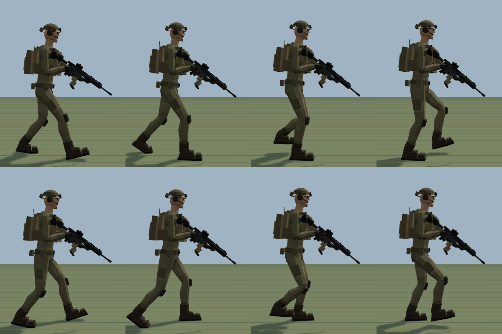
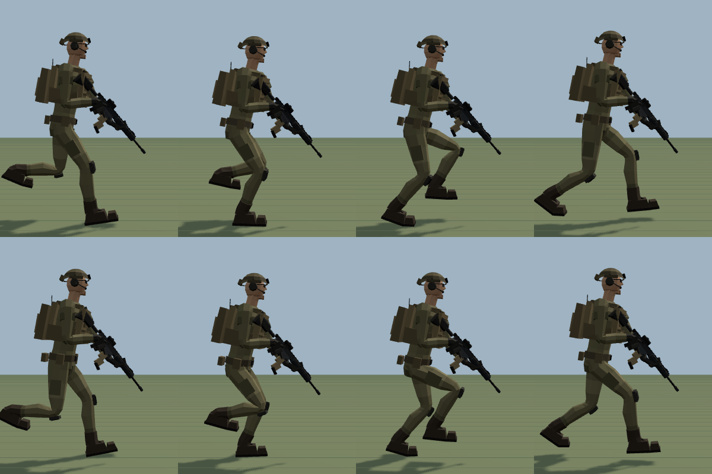
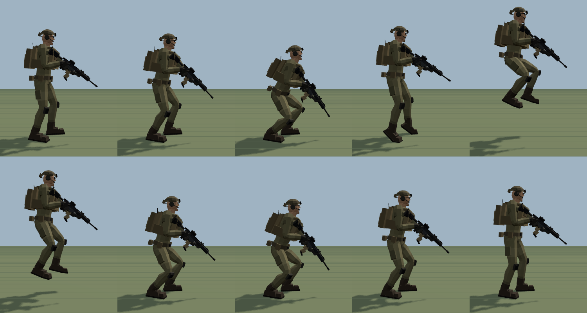
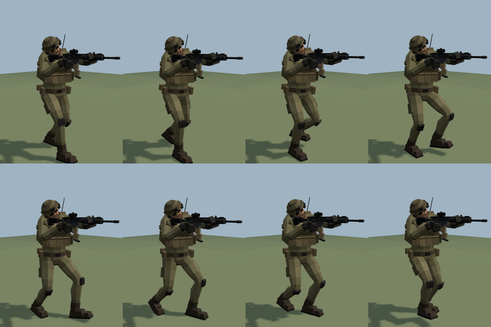
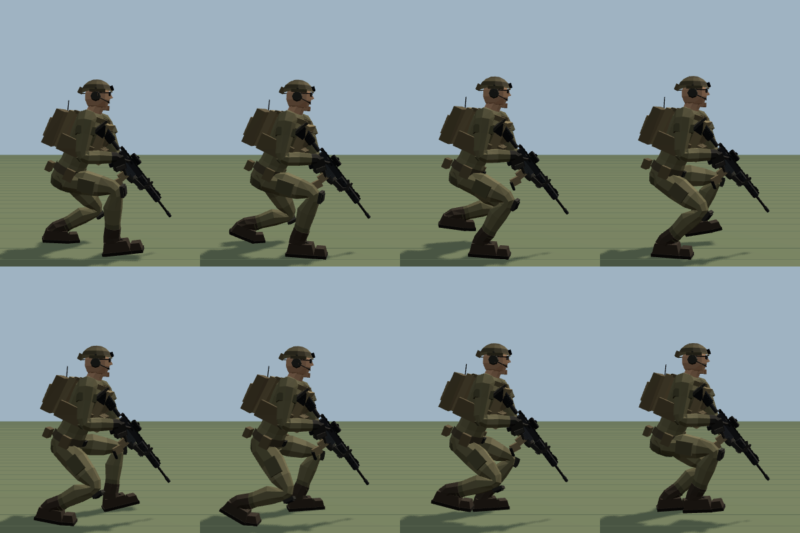
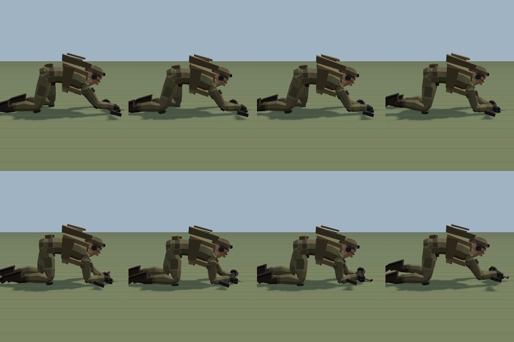
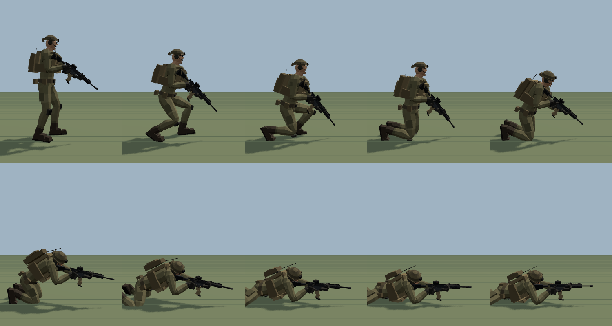
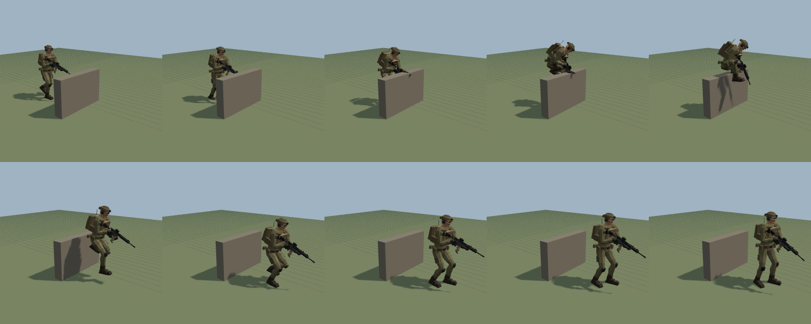

# Animation reference

All clips are baked at **60 fps** with a key on every bone (constant tracks are collapsed to two keys) plus `Hips.position`.
Locomotion is **in place**: the character stays at the origin and the clip's `inPlaceSpeed` is the ground speed that keeps the planted feet locked.
Vertical motion (gait bob, jump arc) is baked into `Hips.position`.

## Locomotion

| Clip | Length | Loop | Speed | Notes |
|---|---|---|---|---|
| `Idle` | 4.00 s | ✓ | — | Low ready: butt in the shoulder pocket, muzzle about 30° down, index finger straight along the receiver. 15 breaths/min (chest pitch and clavicle lift), slow weight shift, and a head scan to the left and back. |
| `Walk` | 1.10 s | ✓ | 1.25 m/s | Patrol walk at the low ready, 109 steps/min, 0.69 m step. Stance is 62 % of the cycle. Heel strike with 16° dorsiflexion, heel-off at 40 %, toe-off with 38° heel rise and toe bend. Soft knees through stance. Restrained pelvis: yaw ±3.5°, obliquity ±1.8°, sway ±1.1 cm, bob ±1.9 cm. The thorax counter-rotates and leans into the weight transfer, the shoulders bounce after each footfall, the head nods and settles, and the rifle lags vertically and sideways. |
| `Run` | 0.70 s | ✓ | 4.3 m/s | Combat run: 1.5 m steps at 171 steps/min, stance 28 % (about 0.2 s ground contact) with two flight phases. Midfoot contact, high heel recovery, about 6.8 cm vertical oscillation, 18° trunk lean and thorax counter-rotation. The rifle is carried compact across the chest, muzzle down-left. |
| `ADS_Walk` | 1.20 s | ✓ | 0.9 m/s | Aiming "Groucho" walk: knees bent, smooth rolling heel-to-toe, chest world-locked. Cheek weld kept: the eye stays within 1 mm of the sight line. |
| `HipFire_Walk` | 1.20 s | ✓ | 0.9 m/s | The same rolling gait with the stock clamped under the right arm. |

| `Crouch_Walk` | 1.24 s | ✓ | 0.85 m/s | Low crouched advance: pelvis at about 0.64 m, 24° trunk lean, wide base, rolling heel-to-toe, rifle at the low ready. |
| `Crouch_ADS_Walk` | 1.24 s | ✓ | 0.85 m/s | The same crouched gait while aiming. The chest is world-locked and the cheek weld kept (eye within 2 mm). |
| `Prone_Crawl` | 1.80 s | ✓ | 0.20 m/s | Belly crawl with the torso flat on the ground. The right forearm reaches and plants as the left knee is drawn up sideways along the ground, then the body is pulled and pushed forward over them and the other pair goes. Forearms are planted for 62 % of the cycle and boots drag. The rifle is cradled across both forearms with the muzzle off the ground. |

## Weapon stances and firing

| Clip | Length | Loop | Notes |
|---|---|---|---|
| `ADS_Idle` | 4.00 s | ✓ | Bladed stance with the left foot forward. Butt seated in the right shoulder pocket. The right eye is on the red-dot sight line (solved, see below). Right elbow out, support hand under the handguard. Micro breathing sway. |
| `HipFire_Idle` | 4.00 s | ✓ | Aggressive forward lean. The stock is tucked under the right armpit and clamped by the upper arm. Barrel level and forward, finger on the trigger. |
| `ADS_Fire` | 0.50 s | — | One shot at t = 0.06 s. Trigger press then reset. The muzzle climbs about 2.2° and the stock drives about 2 cm back into the shoulder. The chest and shoulder absorb the kick with a slight delay, then the rifle settles back on target. |
| `ADS_Fire_Auto` | 0.60 s | ✓ | 7 rounds at 700 RPM (shots every 0.0857 s). Impulses are summed periodically for a seamless loop with sustained muzzle rise. |
| `HipFire_Fire` | 0.50 s | — | One shot from the hip. Recoil is larger (about 4.5° climb) because the shoulder isn't supporting the stock. |
| `HipFire_Fire_Auto` | 0.60 s | ✓ | 700 RPM loop from the hip. |
| `Crouch_Idle` | 4.00 s | ✓ | Crouched low ready: left foot flat and forward, right foot back on the ball with the heel up. Breathing and a head scan. |
| `Crouch_ADS_Idle` | 4.00 s | ✓ | Crouched and aiming, with its own solved cheek weld. |
| `Crouch_ADS_Fire` / `_Auto` | 0.50 / 0.60 s | — / ✓ | Single shot and a 700 RPM loop from the crouched aim. |
| `Prone_Idle` | 4.00 s | ✓ | Prone firing position (FM 3-22.9): body angled left of the line of fire, left leg straight, right knee drawn up, propped on both elbows, butt in the shoulder, right eye on the sight line. Slow breathing. |
| `Prone_Fire` / `_Auto` | 0.50 / 0.60 s | — / ✓ | Prone recoil is smaller (about 1.4° climb) because the elbows support the rifle. |
| `*_Pose` | static | ✓ | Single static frames of each stance, for aim offsets and as additive references. |

Shot times (s) are in `animations.json` → `shots`. Use them to spawn muzzle flash and brass at the `Muzzle` and `Ejection` nodes.

## Transitions

These start and end exactly on the corresponding stance frames, so they chain without cross-fades. During each transition the trigger finger comes off the trigger and goes back on only once the rifle has settled.

| Clip | Length | Notes |
|---|---|---|
| `Idle_To_ADS` | 0.32 s | Mounts the rifle: the muzzle rises, the head drops into the cheek weld and the shoulder rises. |
| `ADS_To_Idle` | 0.40 s | Back to the low ready. |
| `Idle_To_HipFire` / `HipFire_To_Idle` | 0.30 / 0.35 s | The stock swings out and around the right arm and into the tuck (arced path). |
| `HipFire_To_ADS` / `ADS_To_HipFire` | 0.28 s | Fast mount and dismount. |

| `Stand_To_Crouch` / `Crouch_To_Stand` | 0.45 / 0.50 s | The body drops while the right foot steps back onto its ball (a real step, not a slide). |
| `Crouch_To_Crouch_ADS` / `Crouch_ADS_To_Crouch` | 0.32 / 0.40 s | Mount and dismount while crouched. |
| `Stand_To_Prone` | 1.75 s | Crouch → drop to both knees (toes tucked) → fall forward onto the forearms with the rifle → legs slide back and spread → settle into the aimed prone position. |
| `Prone_To_Stand` | 1.90 s | The reverse: push up onto the forearms and knees, kneel, crouch, stand at the low ready. |

## Jump

| Clip | Length | Loop | Notes |
|---|---|---|---|
| `Jump` | 1.85 s | — | Full standing jump with the rifle at the low ready: anticipation crouch to 0.73 m hip height, extension with heel rise, take-off at 0.62 s (2.45 m/s), ballistic flight to about 0.31 m, knee tuck, toe-first landing at 1.12 s, absorb and recover. The rifle lags on take-off and dips on landing. |
| `Jump_Start` | 0.62 s | — | Crouch → take-off. Ends with the pelvis at take-off height. |
| `Jump_Air` | 0.80 s | ✓ | Airborne loop with legs tucked and the pelvis held at take-off height. Let your physics drive the real arc. |
| `Jump_Land` | 0.73 s | — | Touchdown → absorb → idle. Starts with the pelvis at take-off height. |
| `Vault` | 1.40 s | — | One-handed vault over a 1.0 m wall, 25 cm thick, near face 1.2 m ahead. Run-in, take off from the left foot, the left hand plants flat on the wall top while the right hand keeps the rifle, knees tuck over with the legs clear of the wall, land on the right foot, step through with the left, settle at the low ready. Root motion: 2.5 m forward in the Hips track. |
| `Vault` | 1.40 s | — | One-handed vault over a 1.0 m wall, 25 cm thick, near face 1.2 m ahead. Run-in, take off from the left foot, the left hand plants flat on the wall top while the right hand keeps the rifle, knees tuck over with the legs clear of the wall, land on the right foot, step through with the left, settle at the low ready. Root motion: 2.5 m forward in the Hips track. |

## Cheek-weld solutions

The aiming head, neck and shoulder postures aren't hand-posed. They are solved so that the **right eye lies on the optic's axis** with the butt seated in the shoulder pocket, within comfortable joint limits. This is done separately for the standing, crouched and prone aim. The cheek weld is about 6–8 cm forward of the butt pad, over the stock comb. The neck pivots low, inside the collar, so a short neck can still bring the head forward onto the stock.

Run `npm run validate` to see the current numbers and `npm run calibrate` to re-solve them after changing a stance or the skeleton.
