# Animation reference

All clips are baked at **60 fps** with a key on every bone (constant tracks are collapsed to two keys) plus `Hips.position`.
Locomotion is **in place**: the character stays at the origin and the clip's `inPlaceSpeed` is the ground speed that keeps the planted feet locked.
Vertical motion (gait bob, jump arc) is baked into `Hips.position`.

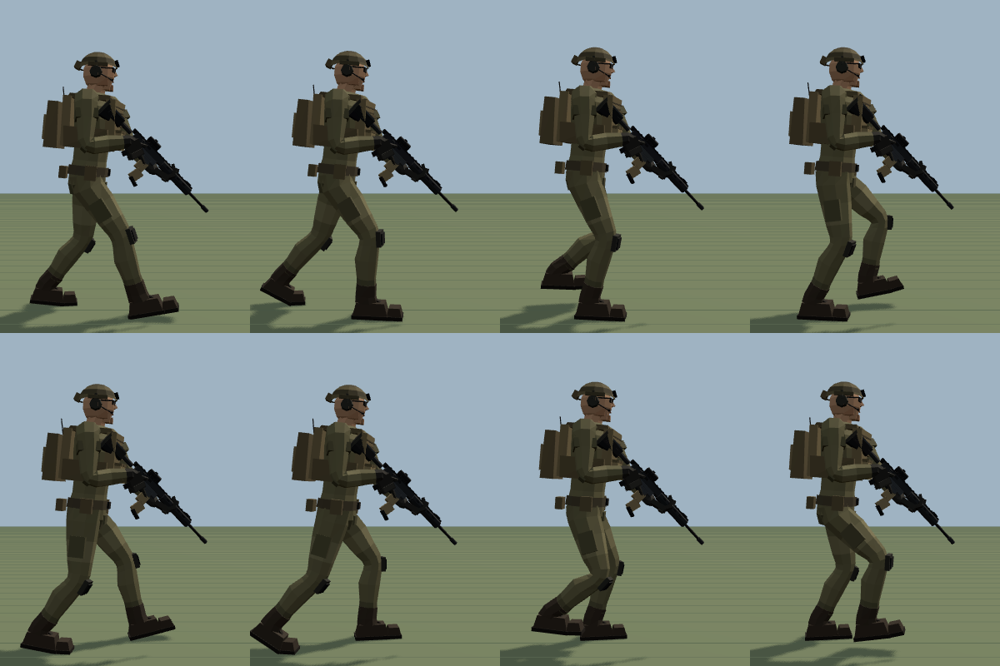
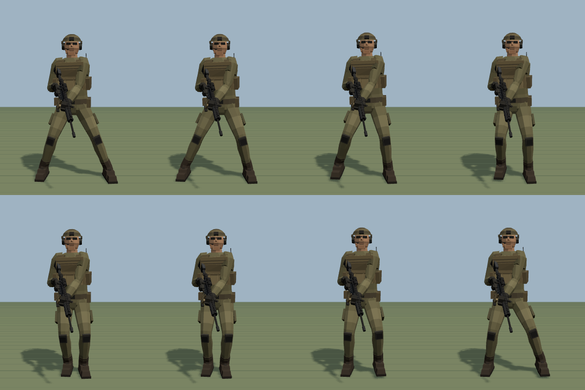
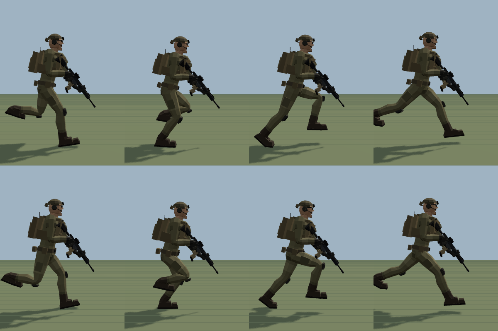
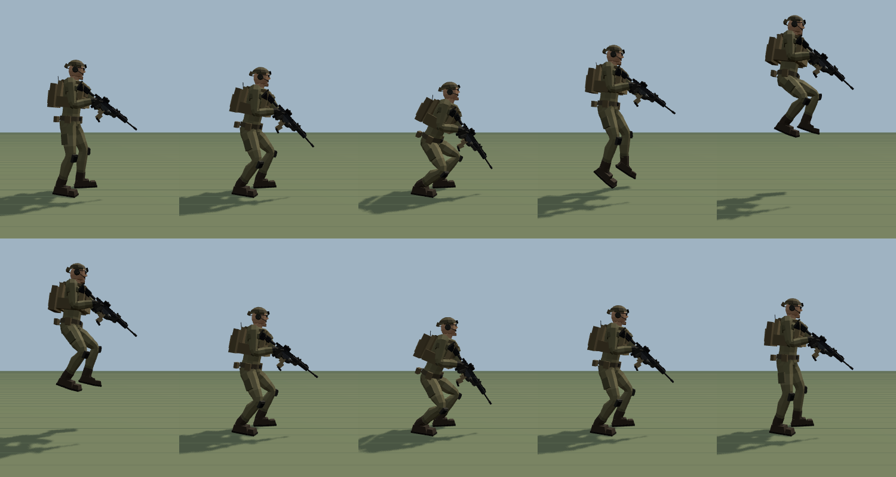
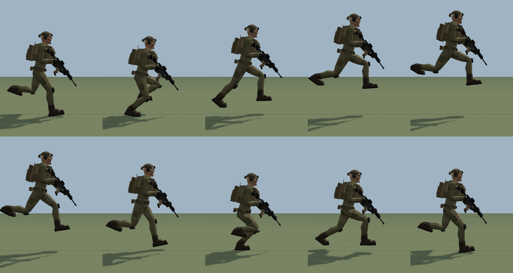
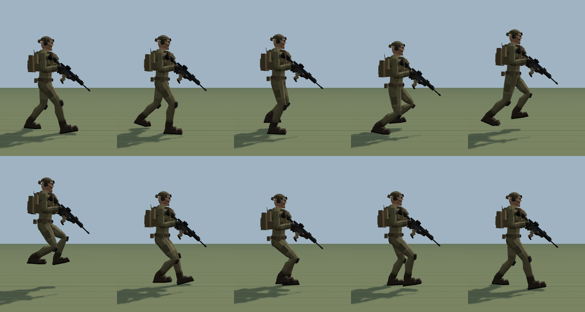
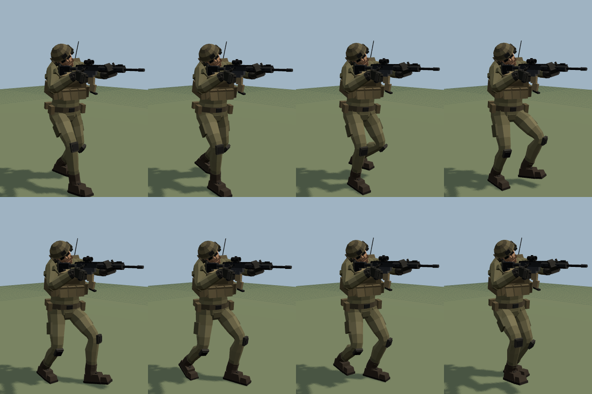
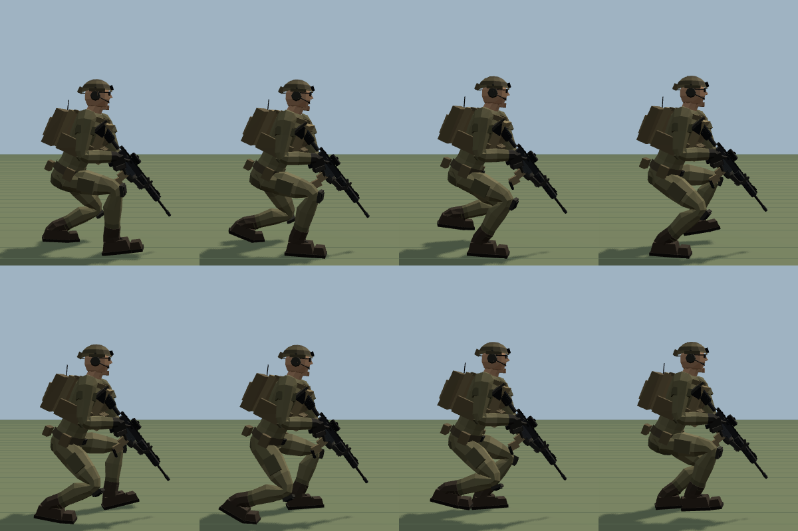
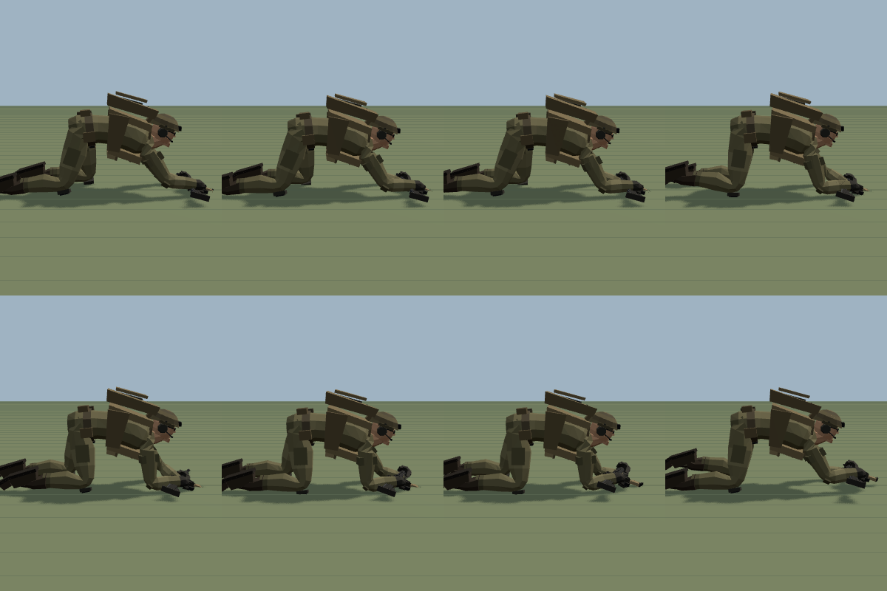
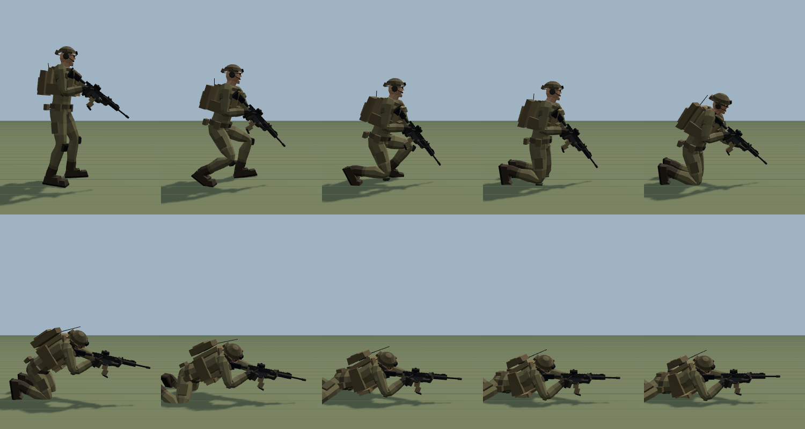
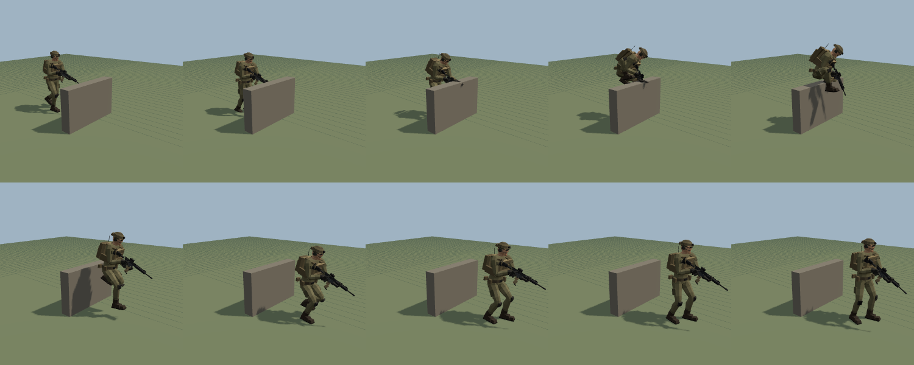

## Locomotion

| Clip | Length | Loop | Speed | Notes |
|---|---|---|---|---|
| `Idle` | 4.00 s | ✓ | — | Low ready: butt in the shoulder pocket, muzzle about 30° down, index finger straight along the receiver. 15 breaths/min (chest pitch and clavicle lift), slow weight shift, and a head scan to the left and back. |
| `Walk` | 1.18 s | ✓ | 1.15 m/s | Relaxed patrol walk, 102 steps/min, 0.68 m step. Stance is 62 % of the cycle. Soft knees, nearly extended at mid-stance (about 16–34° through the step). Soft heel strike (12° dorsiflexion), heel-off at 40 %, an easy toe-off with 32° heel rise. Restrained pelvis: yaw ±3.5°, obliquity ±1.8°, sway ±1.1 cm, bob ±1.5 cm. Upright torso (about 1° chest lean, 2° pelvic tilt) with the shoulders dropped. The rifle is carried low and close at a relaxed low ready and swings a little more loosely with each footfall. The thorax counter-rotates, the shoulders bounce after each footfall, and the head nods and settles. |
| `Run` | 0.66 s | ✓ | 5.2 m/s | Fast combat run: 1.7 m steps at 182 steps/min, stance 25 % (about 0.165 s ground contact) with two flight phases. Midfoot contact, high heel recovery, a single clean rise and fall per step, 18° trunk lean and thorax counter-rotation. The rifle is carried compact across the chest, muzzle down-left. |
| `ADS_Walk` | 1.20 s | ✓ | 0.9 m/s | Aiming "Groucho" walk: knees bent, smooth rolling heel-to-toe, chest world-locked. Cheek weld kept: the eye stays within 1 mm of the sight line. |
| `HipFire_Walk` | 1.20 s | ✓ | 0.9 m/s | The same rolling gait with the stock clamped under the right arm. |
| `Strafe_Left` / `Strafe_Right` | 0.86 s | ✓ | 0.70 m/s sideways | Side-step at the low ready. The lead foot steps out about 0.36 m and the trailing foot closes up without crossing. Feet stay flat and pointing forward, the pelvis shifts over each stance foot and dips slightly in double support, and the rifle sways a little sideways. Planted feet move at exactly the strafe speed. In place, travelling sideways (+X left, −X right). |
| `ADS_Strafe_Left` / `ADS_Strafe_Right` | 0.95 s | ✓ | 0.53 m/s sideways | Aimed side-step: lower, smoother, bladed stance with the chest locked and the cheek weld kept (eye within 1 mm of the sight line). |

| `Crouch_Walk` | 1.24 s | ✓ | 0.85 m/s | Low crouched advance: pelvis at about 0.64 m, 24° trunk lean, wide base, rolling heel-to-toe, rifle at the low ready. |
| `Crouch_ADS_Walk` | 1.24 s | ✓ | 0.85 m/s | The same crouched gait while aiming. The chest is world-locked and the cheek weld kept (eye within 2 mm). |
| `Prone_Crawl` | 1.80 s | ✓ | 0.20 m/s | Belly crawl with the torso flat on the ground. The right forearm reaches and plants as the left knee is drawn up sideways along the ground, then the body is pulled and pushed forward over them and the other pair goes. Forearms are planted for 62 % of the cycle and boots drag. The rifle is cradled across both forearms with the muzzle off the ground. |

## Weapon stances and firing

| Clip | Length | Loop | Notes |
|---|---|---|---|
| `ADS_Idle` | 4.00 s | ✓ | Bladed stance with the left foot forward. Butt seated in the right shoulder pocket. The right eye is on the red-dot sight line (solved, see below). Right elbow out, support hand under the handguard. Micro breathing sway. |
| `HipFire_Idle` | 4.00 s | ✓ | Aggressive forward lean. The stock is tucked under the right armpit and clamped by the upper arm. Barrel level and forward, finger on the trigger. |
| `ADS_Fire` | 0.50 s | — | One shot at t = 0.06 s. Trigger press then reset. The muzzle climbs about 2.2° and the stock drives about 2 cm back into the shoulder. The chest and shoulder absorb the kick with a slight delay, then the rifle settles back on target. |
| `ADS_Fire_Auto` | 0.60 s | ✓ | 7 rounds at 700 RPM (shots every 0.0857 s). Impulses are summed periodically for a seamless loop with sustained muzzle rise. |
| `HipFire_Fire` | 0.50 s | — | One shot from the hip. Recoil is larger (about 4.5° climb) because the shoulder isn't supporting the stock. |
| `HipFire_Fire_Auto` | 0.60 s | ✓ | 700 RPM loop from the hip. |
| `Crouch_Idle` | 4.00 s | ✓ | Crouched low ready: left foot flat and forward, right foot back on the ball with the heel up. Breathing and a head scan. |
| `Crouch_ADS_Idle` | 4.00 s | ✓ | Crouched and aiming, with its own solved cheek weld. |
| `Crouch_ADS_Fire` / `_Auto` | 0.50 / 0.60 s | — / ✓ | Single shot and a 700 RPM loop from the crouched aim. |
| `Prone_Idle` | 4.00 s | ✓ | Prone firing position (FM 3-22.9): body angled left of the line of fire, left leg straight, right knee drawn up, propped on both elbows, butt in the shoulder, right eye on the sight line. Slow breathing. |
| `Prone_Fire` / `_Auto` | 0.50 / 0.60 s | — / ✓ | Prone recoil is smaller (about 1.4° climb) because the elbows support the rifle. |
| `*_Pose` | static | ✓ | Single static frames of each stance, for aim offsets and as additive references. |

Shot times (s) are in `animations.json` → `shots`. Use them to spawn muzzle flash and brass at the `Muzzle` and `Ejection` nodes.

## Transitions

These start and end exactly on the corresponding stance frames, so they chain without cross-fades. During each transition the trigger finger comes off the trigger and goes back on only once the rifle has settled.

| Clip | Length | Notes |
|---|---|---|
| `Idle_To_ADS` | 0.32 s | Mounts the rifle: the muzzle rises, the head drops into the cheek weld and the shoulder rises. |
| `ADS_To_Idle` | 0.40 s | Back to the low ready. |
| `Idle_To_HipFire` / `HipFire_To_Idle` | 0.30 / 0.35 s | The stock swings out and around the right arm and into the tuck (arced path). |
| `HipFire_To_ADS` / `ADS_To_HipFire` | 0.28 s | Fast mount and dismount. |

| `Stand_To_Crouch` / `Crouch_To_Stand` | 0.45 / 0.50 s | The body drops while the right foot steps back onto its ball (a real step, not a slide). |
| `Crouch_To_Crouch_ADS` / `Crouch_ADS_To_Crouch` | 0.32 / 0.40 s | Mount and dismount while crouched. |
| `Stand_To_Prone` | 1.75 s | Crouch → drop to both knees (toes tucked) → fall forward onto the forearms with the rifle → legs slide back and spread → settle into the aimed prone position. |
| `Prone_To_Stand` | 1.90 s | The reverse: push up onto the forearms and knees, kneel, crouch, stand at the low ready. |

## Jump

| Clip | Length | Loop | Notes |
|---|---|---|---|
| `Jump` | 1.85 s | — | Standing two-footed jump with the rifle at the low ready, taking off almost at once: a quick dip (hips to 0.76 m) and explosive extension with heel rise, take-off at 0.31 s, 0.82 s of ballistic flight to about 0.8 m, knee tuck, toe-first landing at 1.13 s, absorb and recover. |
| `Run_Jump` / `Run_Jump_Left` | 1.20 s | — | Powerful running leap taken out of the run cycle, off the right or the left foot. The take-off and landing stances run at the normal run rate, so planted feet move at exactly 5.2 m/s. The flight is stretched to 0.82 s of true ballistic flight (about 0.8 m rise, about 4.3 m in the air at run speed) with a strong knee drive. A damped landing absorbs it and hands back to `Run` at the same phase. |
| `Walk_Jump` / `Walk_Jump_Left` | 1.66 s | — | Walking leap in the same style, built from the walk cycle. The take-off foot pushes off early, 0.3 s after its heel strike (a hop out of the walk), into 0.58 s of flight (about 41 cm rise). The other leg's swing is lengthened so it lands only after the flight, and each foot runs on its own eased timing so nothing slides. It hands back to `Walk` at the same phase. |
| `Jump_Start` | 0.62 s | — | Crouch → take-off. Ends with the pelvis at take-off height. |
| `Jump_Air` | 0.80 s | ✓ | Airborne loop with legs tucked and the pelvis held at take-off height. Let your physics drive the real arc. |
| `Jump_Land` | 0.73 s | — | Touchdown → absorb → idle. Starts with the pelvis at take-off height. |
| `Vault` | 1.40 s | — | One-handed vault over a 1.0 m wall, 25 cm thick, near face 1.2 m ahead. Run-in, take off from the left foot, the left hand plants flat on the wall top while the right hand keeps the rifle, knees tuck over with the legs clear of the wall, land on the right foot, step through with the left, settle at the low ready. Root motion: 2.5 m forward in the Hips track. |

## Cheek-weld solutions

The aiming head, neck and shoulder postures aren't hand-posed. They are solved so that the **right eye lies on the optic's axis** with the butt seated in the shoulder pocket, within comfortable joint limits. This is done separately for the standing, crouched and prone aim. The cheek weld is about 6–8 cm forward of the butt pad, over the stock comb. The neck pivots low, inside the collar, so a short neck can still bring the head forward onto the stock. The stock seats 4.5 cm inboard of the shoulder pocket (2 cm when prone), toward the collarbone, so the rifle sits more under the face and the head tilts only about 6° at the neck and 6° at the head (previously 14° + 14°).

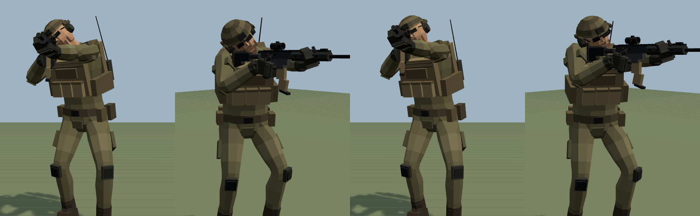

The support hand holds the handguard 3 cm lower, and 8 cm further back toward the body (elbow bent), when aiming, so its fingers stay out of the sight window and the arm looks relaxed. Through the optic, before (left) and after (right):

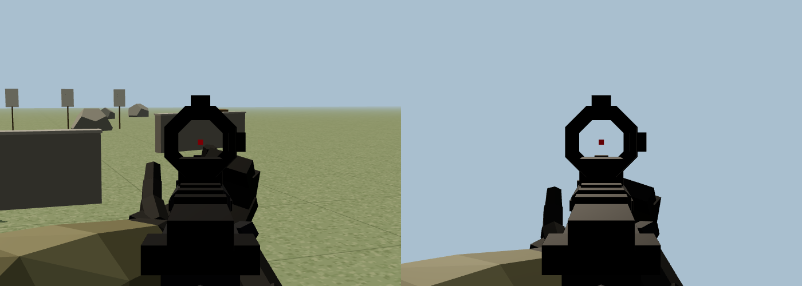

From outside, from the right side (left) and the left side (right):

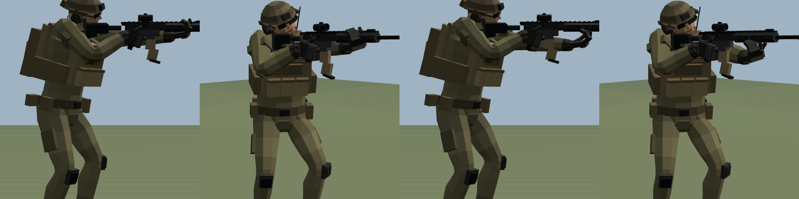

Run `npm run validate` to see the current numbers and `npm run calibrate` to re-solve them after changing a stance or the skeleton.
